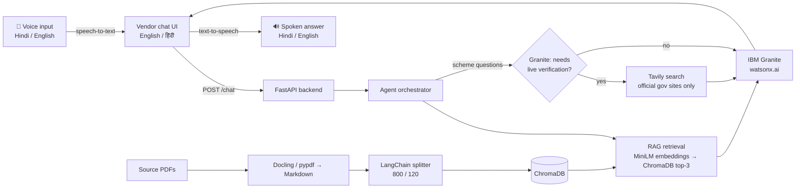

# VendorMitra AI

**A bilingual (English/Hindi) agentic AI assistant that helps Indian street vendors find government schemes, go digital, and grow their business.**

Built with **IBM Granite on watsonx.ai**, a **RAG pipeline (ChromaDB)**, and **live verification against official government websites**.

### 🌐 Live demo: [vendormitra-ai.onrender.com](https://vendormitra-ai.onrender.com/)

> If the app has been idle, the first load can take up to a minute while the server wakes up. Please wait and refresh once.

**Try these:**
- `Am I eligible for PM SVANidhi?`
- `क्या मैं पीएम स्वनिधि योजना के लिए पात्र हूँ?`
- `How can I accept UPI payments at my stall?`
- `I sell fruit in Pune Camp. Write a business profile for my stall.`
- Tap the **microphone** button and speak your question in Hindi or English. The answer is read back to you aloud.
- Choose **Create promotional materials** for a WhatsApp message, signboard line and QR-poster copy.

---


## The problem

Millions of street vendors in India struggle to:

- find and understand government schemes such as PM SVANidhi, MUDRA and Udyam
- accept digital payments (UPI/QR) and build an online presence
- get reliable guidance in their own language

VendorMitra answers these questions in simple English or Hindi, with sources the vendor can check.

## Problem Statement 29 coverage

Built for **Problem Statement 29: Street Vendor Digitalization Agent** (IBM Granite / IBM Cloud is mandatory).

| Requirement | Status | How |
|---|---|---|
| RAG-powered agent | ✅ | ChromaDB + multilingual embeddings, top-3 retrieval |
| IBM Granite | ✅ | `ibm/granite-4-h-small` on IBM watsonx.ai, authenticated with IBM Cloud IAM |
| Business profiles | ✅ | Extracts products and area from "I sell fruit in Pune Camp" and drafts the profile |
| UPI setup guides, QR setup | ✅ | `upi_setup` task plus BHIM UPI guidelines; QR-poster copy (placeholders only, no payment QR is generated) |
| Local SEO and customer engagement tips | ✅ | Dedicated tasks and practical guides |
| Promotional materials | ✅ | WhatsApp message, signboard line, QR-poster text |
| Real-time policies and MSME schemes | ✅ | Live search of allowlisted official sites, with links and dates |
| Access to credit | ✅ | PM SVANidhi, MUDRA and Udyam guidance |
| Pricing tips, online listing platforms | 🟡 | Practical guides; no live market prices |
| Local language | 🟡 | English and Hindi (text and voice); Marathi and more planned |
| Voice access for low-literacy users | ✅ | Hindi and English voice input (speech-to-text) and spoken answers (text-to-speech) |
| Geolocation of business data, consumer behaviour insights | 🔜 | Planned (see Roadmap) |

## Features

- **Grounded answers (RAG):** retrieves passages from government documents and vendor guides stored in ChromaDB.
- **Agent-decided live verification:** for scheme questions, Granite decides whether current information is needed, then searches only allowlisted official sites (myScheme, PM SVANidhi, Udyam, MUDRA, MoHUA) via Tavily.
- **Transparent sources:** stored-document information is labelled separately from live website information, with clickable official links and retrieval dates.
- **Safe fallback:** if live search fails, the assistant uses stored documents and says it could not verify online.
- **Bilingual:** replies in Hindi automatically when the question uses Devanagari; English/Hindi selector in the UI.
- **Voice in, voice out (Hindi and English):** tap the microphone and speak instead of typing. Speech is recognised in Hindi (`hi-IN`) or Indian English (`en-IN`) based on the selected language, and the transcript appears in the message box so the vendor can check or edit it before sending. The assistant's answer is then spoken back in the same language, so vendors who find reading difficult can use the whole chat by voice.
- **Digital presence tools:** business profiles, WhatsApp messages, signboard lines, QR-poster copy, plus UPI, local-listing and customer-engagement guidance.
- **Personalization:** a saved vendor profile (name, products, location) tailors the answers.
- **Private by design:** chat history and profile stay in the browser (localStorage); location is never sent to a third-party service. Only the transcribed text of a voice message reaches the backend.

## How it works



1. The vendor types or speaks a question. Spoken input is converted to text in the browser, and the browser sends the question, language and vendor profile to `POST /chat`.
2. The agent retrieves the top three matching passages from ChromaDB.
3. For scheme questions, Granite decides whether live verification is needed. If so, Tavily searches the allowlisted official domains.
4. Granite writes a grounded answer from the labelled PDF and live context, in the right language.
5. The API returns the answer, source labels and official links. The chat shows the answer and reads it aloud in the same language.

More detail: [`street-vendor-agent/docs/architecture.md`](street-vendor-agent/docs/architecture.md)

## Tech stack

| Area | Technology |
|---|---|
| LLM | IBM Granite 4 H Small (`ibm/granite-4-h-small`) on IBM watsonx.ai |
| Auth | IBM Cloud IAM (cached bearer token, auto-refresh) |
| Retrieval | ChromaDB, `paraphrase-multilingual-MiniLM-L12-v2`, LangChain text splitters |
| Live search | Tavily Search API (official-domain allowlist) |
| Document ingestion | Docling (optional) / pypdf, OCR support via `.ocr.pdf` |
| Backend | Python 3.12, FastAPI, Uvicorn |
| Frontend | HTML/JavaScript chat UI, browser localStorage, Hindi/English voice input and spoken answers |
| Dev tools | IBM Bob, GitHub |
| Hosting | Render |

## Quick start

```bash
git clone https://github.com/adityapattnaik393-glitch/VendorMitra-AI.git
cd VendorMitra-AI/street-vendor-agent/backend

python3.12 -m venv .venv
source .venv/bin/activate          # Windows PowerShell: .\.venv\Scripts\Activate.ps1
python -m pip install -r requirements.txt
cp .env.example .env               # Windows PowerShell: Copy-Item .env.example .env
```

Edit `.env` and set:

```env
IBM_API_KEY=your_ibm_api_key
IBM_PROJECT_ID=your_watsonx_project_id
IBM_REGION=us-south
TAVILY_API_KEY=your_tavily_key     # enables live official-site search
```

Then:

```bash
# 1. Check credentials and model access
python -m app.check_granite

# 2. Convert source PDFs to Markdown
python -m app.ingest

# 3. Start the server (http://127.0.0.1:8000)
python -m app.main
```

```bash
# 4. In another terminal, index the documents (needed once on a fresh clone)
curl -X POST http://127.0.0.1:8000/ingest
```

5. Open <http://127.0.0.1:8000> and start chatting.

## Deployment

The live demo runs on **Render** as a web service.

| Setting | Value |
|---|---|
| Root directory | `street-vendor-agent/backend` |
| Build command | `pip install -r requirements.txt` |
| Start command | `python -m app.main` (reads the `PORT` variable automatically) |
| Environment variables | `IBM_API_KEY`, `IBM_PROJECT_ID`, `IBM_REGION`, `IBM_MODEL_ID` (optional), `TAVILY_API_KEY` |

After a fresh deploy, call `POST /ingest` once to build the vector index, because the ChromaDB folder is not stored in the repository. Check `GET /health` to confirm Granite is configured and chunks are indexed.

## API

| Method | Path | Purpose |
|---|---|---|
| GET | `/` | Chat interface |
| GET | `/health` | IBM configuration and vector-store status |
| GET | `/granite/test` | Real Granite test request |
| POST | `/ingest` | Index Markdown documents in ChromaDB |
| POST | `/chat` | Retrieve context and generate an answer |

```bash
curl -X POST http://127.0.0.1:8000/chat \
  -H "Content-Type: application/json" \
  -d '{"question":"How can I accept UPI payments?","response_language":"Hindi","task":"upi_setup"}'
```

Interactive API docs are available at `/docs`.

## Project structure

```text
street-vendor-agent/
├── backend/
│   ├── app/
│   │   ├── main.py          # FastAPI routes
│   │   ├── agent.py         # intent, profile extraction, retrieval orchestration
│   │   ├── rag.py           # chunking, embeddings, ChromaDB
│   │   ├── web_search.py    # Tavily + official-domain filtering
│   │   ├── granite.py       # IBM IAM + watsonx.ai requests
│   │   ├── ingest.py        # PDF → Markdown
│   │   ├── check_granite.py # credential / model preflight
│   │   └── chat.html        # bilingual chat UI
│   ├── data/raw/            # source PDFs and datasets
│   ├── data/processed/      # Markdown for indexing
│   └── tests/               # unit tests
└── docs/architecture.md
```

## Limitations

- Answers depend on the indexed documents and retrieve at most three passages.
- Live search needs a Tavily API key and network access; otherwise the app falls back to stored PDFs.
- The PM SVANidhi dataset is historical (as of 2024-01-30), not live data.
- Pricing and listing guidance is general; it does not use live market prices.
- Romanized Hindi (Hinglish) follows the language chosen in the UI; automatic detection covers Devanagari only.
- Voice input needs microphone permission and a browser that supports speech recognition (Chrome and Edge work best). Recognition accuracy depends on the device, accent and background noise, and the audio is processed by the browser's speech service, not by VendorMitra's backend. How natural the spoken answers sound depends on the Hindi and English voices available on the vendor's device.
- Scheme rules change. Always confirm eligibility, fees and deadlines on the official website.

## Roadmap

- **More languages for voice and text:** Marathi, Tamil, Bengali and other regional languages, building on today's Hindi and English voice input and spoken answers, for low-literacy users.
- **Geolocation insights:** use the vendor's area for nearby markets, listing options and local advice.
- **WhatsApp delivery:** reach vendors where they already are.
- **Application assistance:** step-by-step help for PM SVANidhi, MUDRA and Udyam, with eligibility matching and deadline reminders.
- **Digital commerce integration:** UPI and ONDC onboarding.

## Tests

```bash
cd street-vendor-agent/backend
python -m unittest discover -s tests
```

## Security note

Never commit `.env` or your IBM/Tavily keys. The app treats retrieved text as data (not instructions) and never invents URLs or scheme rules.

## License

Released under the [MIT License](LICENSE).

## Author

**Aditya Pattnaik**
